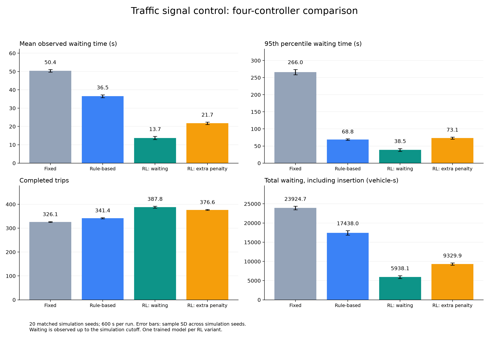
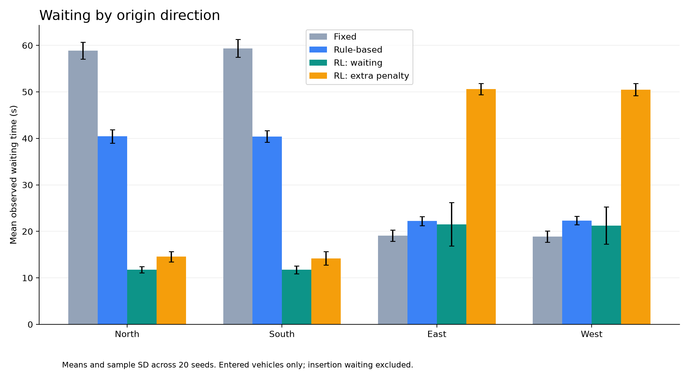

# Learning Reinforcement Learning Through Traffic Simulation

A hands-on comparison of fixed-time signals, a queue-based rule controller and two PPO agents at a simulated intersection.

**On 20 matched simulation seeds, the waiting-focused PPO model achieved a mean observed waiting time of 13.71 s, compared with 50.39 s for the supplied fixed-time program and 36.52 s for the rule controller.** A second PPO variant with an additional long-wait penalty performed worse than the first PPO model.

This is a simulation study and learning project, not a validated controller for public-road deployment.

## Question

Can reinforcement learning reduce waiting compared with a fixed signal schedule and a simple adaptive rule, while avoiding excessive waiting for individual vehicles and directions?

The project compares four concrete controllers rather than assuming that reinforcement learning or an additional penalty must improve performance.

## Scenario and attribution

The road network and traffic demand are supplied by [SUMO-RL](https://github.com/LucasAlegre/sumo-rl), using its `2way-single-intersection` scenario:

- `single-intersection.net.xml`
- `single-intersection-vhvh.rou.xml`

SUMO 1.28.0 performs the traffic simulation. This project's controllers interact with SUMO through TraCI. The RL environment is a custom Gymnasium environment; it does **not** use the standard SUMO-RL `SumoEnvironment` or its default reward/action definitions. SUMO-RL is used here as the source of the scenario files.

Project-specific work includes the queue-based controller, constrained RL action interface, two reward formulations, directional measurements, paired-seed evaluation and CSV consistency checks. SUMO, PPO, the neural-network implementation and the road scenario are existing tools, not original contributions of this project.

## Controllers

### Fixed-time reference

The original network program cycles through four green phases lasting **33, 6, 33 and 6 s**, separated by **2 s yellow phases**. The full cycle lasts 86 s. This supplied program was not optimized for the comparison demand.

### Queue-based adaptive rule

The controller preserves the cyclic order of all phases. Each green lasts at least 5 s and at most 40 s. After the minimum duration, it ends the green if its served lanes have no stopped vehicles, or if another green phase's served lanes contain at least three more stopped vehicles. Yellow lasts 2 s.

Each incoming lane is counted once when computing a phase's queue. The controller uses an explicit simulation clock and transitions through yellow; it does not jump directly between greens.

The seed-42 timing check reported zero green-duration violations, yellow-duration violations or phase-order errors. These checks are not a complete real-world signal-safety validation.

### PPO: waiting-focused

The agent selects one of two actions each simulated second:

- `0`: hold the current green.
- `1`: request its end and move to the next yellow phase.

Requests before the 5 s minimum are ignored. A green ends compulsorily at 40 s. Yellow transitions after 2 s independently of the action. The cyclic phase order is fixed.

The 27 observations contain eight incoming-lane stopped counts, eight lane vehicle counts, an eight-element phase indicator, elapsed phase time, episode progress and the number of vehicles waiting for insertion. Counts are scaled by 20, phase time by 40 and episode time by the episode duration. These scaled counts are not lane-capacity densities.

For each one-second step:

```text
base_reward = -(stopped_vehicles + pending_insertion_vehicles) / 100
```

Including pending insertion avoids rewarding a controller merely because congestion prevents vehicles from entering the simulated roads. PPO optimizes discounted return, so its training objective is not exactly the undiscounted evaluation total.

### PPO: additional long-wait penalty

This variant uses 35 observations: the original 27 plus the maximum tracked cumulative stopped time among vehicles currently in each incoming lane, scaled by 30 s.

It also adds:

```text
excess = sum over vehicles currently in the network:
         max(0, cumulative_stopped_time - 30) / 30

reward = base_reward - 2 × excess / 100
```

Cumulative stopped time is tracked from entry into the network. Once a vehicle exceeds the threshold, the added penalty remains while that vehicle is in the network, even if it starts moving; it stops contributing when it leaves. The added term excludes vehicles still waiting for insertion, which remain covered by the base reward.

The filename `ppo_fair.zip` describes the design intention, not demonstrated fairness. This variant changes both reward and observations, so the experiment does not isolate the reward term alone.

## Training

Both PPO variants were trained from scratch using Stable-Baselines3 on CPU.

| Setting | Value |
|---|---:|
| Policy | MlpPolicy |
| Actor hidden layers | 64, 64 |
| Critic hidden layers | 64, 64 |
| Learning rate | 0.0003 |
| Rollout length | 2,048 steps |
| Batch size | 64 |
| Discount factor | 0.99 |
| Training seed | 42 |
| Requested timesteps | 200,000 per variant |
| Episode horizon | 600 simulated seconds |

Other settings use the installed library defaults. PPO completes the final rollout, so the requested budget may be exceeded slightly. Training resets draw SUMO seeds from a seeded generator. One model was trained per RL variant.

## Evaluation

- Four controllers × 20 shared SUMO seeds, **1000–1019**: 80 runs.
- Each run lasts 600 simulated seconds, with a 1 s step.
- RL actions are deterministic and model weights stay fixed.
- All runs use the same network and demand file.
- A preliminary seed-42 test was used during development; the table below reports the 20-run comparison.

### Metric definitions

- **Observed waiting:** sampled seconds with vehicle speed below 0.1 m/s, accumulated after network entry and before the 600 s cutoff.
- **P95 / maximum:** calculated within each run, then averaged over the 20 runs. The P95 shown is not a percentile of all pooled vehicle records.
- **Completed trips:** arrivals before the cutoff.
- **Total waiting:** stopped-vehicle seconds inside the network plus pending-insertion vehicle-seconds.
- **Direction:** the origin direction inferred from the first route edge. Directional waiting excludes insertion waiting.

Unfinished trips are included with the waiting observed so far. This is censored, finite-horizon measurement, not complete lifetime trip waiting. Different controllers can admit different sets of vehicles before the cutoff.

### Results: means across 20 simulation seeds

| Controller | Mean waiting (s) | Mean run P95 (s) | Mean run maximum (s) | Vehicles over 30 s (%) | Completed trips | Total waiting (vehicle-s) |
|---|---:|---:|---:|---:|---:|---:|
| Fixed | 50.39 | 266.02 | 340.95 | 41.56 | 326.05 | 23,924.65 |
| Rule-based | 36.52 | 68.81 | 83.95 | 62.66 | 341.35 | 17,438.00 |
| **PPO: waiting** | **13.71** | **38.48** | **56.20** | **12.80** | **387.80** | **5,938.10** |
| PPO: extra penalty | 21.74 | 73.15 | 101.85 | 18.35 | 376.60 | 9,329.90 |



The waiting-focused PPO model reduced mean observed waiting by approximately **62.5% relative to the rule controller** and completed about **46 more trips per run**. Relative to the supplied fixed-time program, mean observed waiting was about **72.8% lower**.

### Directional waiting

Values are means of per-run directional mean waiting times.

| Controller | North (s) | South (s) | East (s) | West (s) |
|---|---:|---:|---:|---:|
| Fixed | 58.88 | 59.36 | 19.08 | 18.89 |
| Rule-based | 40.43 | 40.41 | 22.22 | 22.33 |
| PPO: waiting | 11.74 | 11.74 | 21.51 | 21.25 |
| PPO: extra penalty | 14.56 | 14.18 | 50.61 | 50.50 |



The extra-penalty model increased mean waiting in every origin direction relative to the waiting-focused PPO model. East/West waiting exceeded 50 s. The added mechanism therefore did not achieve its intended benefit in this experiment. The measurements do not determine whether the cause was reward design, optimization, observation changes or training randomness.

The rule controller reduced extreme waiting compared with fixed-time control while increasing the fraction above 30 s. This illustrates why a single threshold statistic is insufficient.

### Data checks

The local validation reported:

- 80 unique controller/seed records, 20 per controller.
- 320 unique controller/seed/direction records.
- 32,801 vehicle records, unique within controller/seed/vehicle ID.
- No missing episode values and no teleport events.
- Successful reconstruction of episode and directional statistics from vehicle records, including total waiting accounting.

Plot error bars show sample standard deviations across simulation seeds, not confidence intervals or variability across separately trained models.

## Reproduce on Windows

Use Python 3.11. From the project directory:

```powershell
py -3.11 -m venv .venv
.\.venv\Scripts\python.exe -m pip install --upgrade pip
.\.venv\Scripts\python.exe -m pip install eclipse-sumo sumo-rl stable-baselines3 pandas matplotlib
```

For exact dependency reproduction, export the actual working environment and keep that file in the repository:

```powershell
.\.venv\Scripts\python.exe -m pip freeze | Out-File -Encoding utf8 requirements.txt
```

Later installations should use `pip install -r requirements.txt`. The project was run with SUMO 1.28.0; installing unpinned packages may produce different versions. Keep the scenario XML files, package versions and source attribution with the experiment if archiving it for reproducibility.

### Inspect and measure references

```powershell
.\.venv\Scripts\python.exe 01_watch_fixed.py
.\.venv\Scripts\python.exe 02_measure_fixed.py
.\.venv\Scripts\python.exe 03_inspect_phases.py
.\.venv\Scripts\python.exe 05_measure_adaptive-2.py
```

`05_measure_adaptive-2.py` is the final adaptive measurement/timing-check script. `04_measure_adaptive.py` is an earlier development version and is not required for the final workflow. Use the final `adaptive_controller.py` with explicit phase timing.

### Check environments and train

```powershell
.\.venv\Scripts\python.exe 06_check_rl_env.py
.\.venv\Scripts\python.exe 07_train_rl_wait.py
.\.venv\Scripts\python.exe 09_train_rl_fair.py
```

The fair training script runs its own environment check. Training starts from scratch; existing same-named outputs can be overwritten. Checkpoints do not enable automatic resume.

### Evaluate and plot

With `models/ppo_wait.zip` and `models/ppo_fair.zip` present:

```powershell
.\.venv\Scripts\python.exe 08_measure_rl_wait.py
.\.venv\Scripts\python.exe 10_measure_rl_fair.py
.\.venv\Scripts\python.exe 11_compare_controllers.py
.\.venv\Scripts\python.exe 12_analyze_results.py
```

Comparison outputs are in `results/comparison/`: `episodes.csv`, `vehicles.csv`, `summary.csv`, `direction_by_seed.csv` and `direction_summary.csv`. Figures and verified means are in `results/figures/`.

The current implementation uses a single default TraCI connection per Python process. Run controllers sequentially within a process.

## Limitations and next steps

- One intersection, one demand file and a 600 s horizon. Varying a simulation seed does not create new network geometries or independently specified traffic-demand regimes.
- One training seed per PPO variant. More evaluation seeds do not measure training variability.
- The fixed-time reference and the hand-written rule were not extensively tuned.
- The extra-penalty experiment changes observations and reward together; a controlled ablation would give both models the same inputs.
- Episode progress is observable, allowing policies to exploit the finite-horizon demand pattern.
- Waiting is censored at the cutoff; directional statistics omit vehicles not admitted to the network.
- Minimum/maximum timing and phase order are engineering constraints in the simulation, not a real-road safety certification.
- Evaluation-seed disjointness from the randomly sampled training SUMO seeds has not been explicitly audited.

Further work could repeat training, evaluate independently specified demand patterns, tune non-ML baselines and examine service at movement/vehicle level. The current results support a comparison of these saved controllers under this scenario, not a general claim that PPO always outperforms adaptive signals.

## References and acknowledgements

1. **Eclipse SUMO contributors. Eclipse SUMO — Simulation of Urban MObility, version 1.28.0.** Software and official citation metadata: https://github.com/eclipse-sumo/sumo/blob/main/CITATION.cff . SUMO requests citation of the software and its preferred conference paper.
2. **Alvarez Lopez, P., et al. (2018). Microscopic Traffic Simulation using SUMO.** IEEE International Conference on Intelligent Transportation Systems (ITSC). https://doi.org/10.1109/ITSC.2018.8569938
3. **Alegre, L. N. (2019). SUMO-RL.** GitHub repository. https://github.com/LucasAlegre/sumo-rl . Scenario source: https://github.com/LucasAlegre/sumo-rl/tree/main/sumo_rl/nets/2way-single-intersection
4. **Raffin, A., Hill, A., Gleave, A., Kanervisto, A., Ernestus, M., and Dormann, N. (2021). Stable-Baselines3: Reliable Reinforcement Learning Implementations.** Journal of Machine Learning Research, 22(268), 1–8. https://jmlr.org/papers/v22/20-1364.html
5. **Schulman, J., Wolski, F., Dhariwal, P., Radford, A., and Klimov, O. (2017). Proximal Policy Optimization Algorithms.** https://arxiv.org/abs/1707.06347
6. **Farama Foundation. Gymnasium documentation: creating custom environments.** https://gymnasium.farama.org/introduction/create_custom_env/
7. **Eclipse SUMO. TraCI traffic-light control documentation.** https://sumo.dlr.de/docs/TraCI/Change_Traffic_Lights_State.html

The figures and measurements reported here were generated by this project. Upstream code and scenario files retain their original licenses and notices; citations do not replace license compliance.

Author: Alexandros Paschidis
